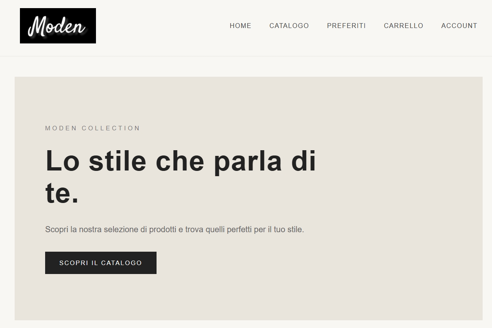

# MODEN

Modern e-commerce frontend built with React and TypeScript.

## Technologies

- React
- TypeScript
- HTML5
- CSS3
- React Router
- Context API
- Vite
- DummyJSON REST API
- LocalStorage

## Features

- Responsive homepage
- Featured products
- Product catalog
- Product search
- Category filtering
- Price sorting
- Product details
- Favorites management
- Shopping cart
- Quantity management
- Automatic cart total calculation
- Simulated checkout
- Customer account
- Persistent data with LocalStorage

## Screenshots

## Installation

bash
git clone YOUR_REPOSITORY_URL
cd moden-react
npm install
npm run dev

## Production Build

bash
npm run build

## API

Product data provided by [DummyJSON](https://dummyjson.com/).

## Notes

This project was developed for learning and portfolio purposes.

The checkout process is simulated. No real payments or backend services are implemented.